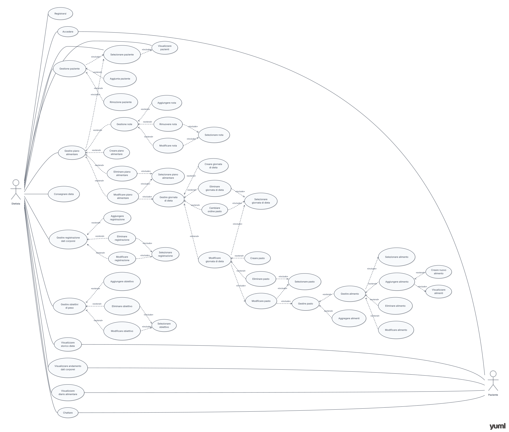
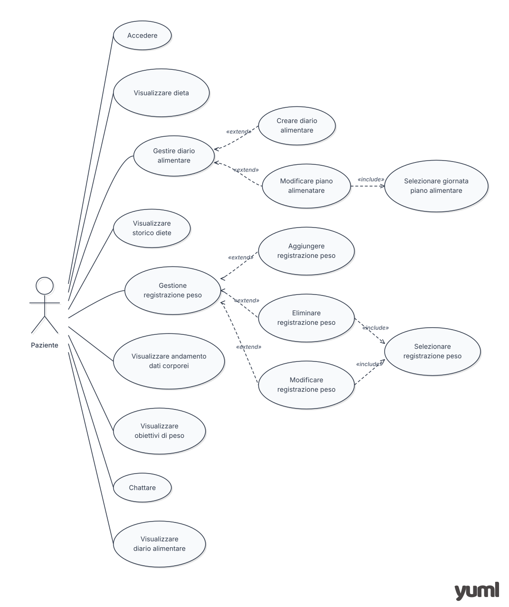

# ProgettoPersonale
## Healthy Eating
### Descrizione
Web app che mette in comunicazione dietisti e pazienti, consentendo ai professionisti di elaborare piani alimentari personalizzati e monitorare l'andamento del peso corporeo dei propri pazienti. Questi ultimi possono consultare il piano alimentare assegnato e registrare il proprio peso, così da monitorare i progressi nel tempo.
### Problema che vuole risolvere
Lentezza nell'aggiornamento dei piani alimentari e monitoraggio poco frequente dell'andamento del peso corporeo dei pazienti.
### Tag line
Una nutrizione più dinamica e connessa
### Target
Dietologi o Nutrizionisti, Pazienti o Atleti
### Attori 
Dietologi o Nutrizionisti, Pazienti e Admin 
### Competitors
FatSecret e YAZIO
### Tecnologie
Javascript (react), node.js

## Attori
 
| Attore | Ruolo |
|---|---|
| Dietista | Crea diete, crea profili clienti e segue i dati clinici del paziente |
| Paziente | Visualizza la dieta, tiene traccia del peso corporeo e dei pasti effettuati |
| Admin | Aggiunge prodotti all'elenco degli alimenti |
 
---

## Analisi dei requisiti

**Funzionali:** descrivono cosa il sistema deve fare, cioè le funzioni che gli utenti possono usare direttamente. 
**Non funzionali:** descrivono come il sistema deve funzionare, cioè le qualità che deve avere e non sono funzioni usate direttamente dall'utente. 
**Di dominio:** sono vincoli imposti dall'esterno, come leggi e normative, che il sistema deve rispettare anche se nessun utente li ha richiesti.

## Funzionali
 
### Dietista
 
| User | Motivazione |
|---|---|
| Come dietista, voglio iscrivermi e creare il mio account | Perché voglio utilizzare il software per i miei pazienti |
| Come dietista, voglio aggiungere un nuovo cliente e inserire i suoi dati | Perché voglio permettere al cliente di usare il software per consegnargli la sua dieta |
| Come dietista, voglio creare/modificare/eliminare un piano alimentare | Perché lo devo consegnare al cliente |
| Come dietista, voglio inserire/modificare/eliminare/cambiare ordine un pasto all'interno di una giornata di dieta | Perché devo strutturare i pasti del cliente all'interno della dieta |
| Come dietista, voglio inserire/modificare/eliminare/cambiare ordine un alimento all'interno di un pasto | Perché devo inserire ogni alimento dosato che il cliente deve consumare ad ogni pasto |
| Come dietista, voglio creare un nuovo alimento inserendo kcal e macronutrienti | Perché l'alimento che voglio dare al cliente non è presente nella lista di alimenti dell'app |
| Come dietista, voglio aggregare più alimenti | Perché devo realizzare piatti unici |
| Come dietista, voglio inserire note vicino ai pasti | Perché devo dare consigli o osservazioni al cliente riguardo a quel pasto |
| Come dietista, voglio inserire e gestire gli alimenti del pasto sgarro | Perché il cliente, se vuole, può richiedere che venga inserito un pasto sgarro periodicamente |
| Come dietista, voglio consegnare un piano alimentare al cliente | Perché il cliente lo veda e inizi il percorso di dieta |
| Come dietista, voglio inserire/modificare/eliminare una registrazione dei dati corporei del cliente | Perché, a seguito di una visita, si deve tenere traccia del percorso effettuato |
| Come dietista, voglio inserire/modificare/eliminare un obiettivo di peso | Perché il cliente deve essere motivato a seguire la dieta e deve avere un obiettivo chiaro |
| Come dietista, voglio visualizzare lo storico delle diete passate | Perché devo vedere i gusti del cliente e sapere cosa mangiava nei mesi in cui è migliorato di più |
| Come dietista, voglio visualizzare i grafici e lo storico dei dati corporei del cliente (peso, altezza, percentuale di grasso, circonferenze) | Perché devo valutare l'andamento del percorso del cliente |
| Come dietista, voglio visualizzare il diario alimentare del paziente | Perché voglio vedere se sta seguendo la dieta |
| Come dietista, voglio visualizzare la stima del metabolismo basale del cliente, calcolata dai dati inseriti con formule esistenti | Perché mi serve per impostare correttamente il fabbisogno calorico del piano alimentare |
| Come dietista, voglio cercare un alimento con risultati divisi per categoria e per proprietà (molto grasso, molto proteico… in base alla densità dei macronutrienti) | Perché devo trovare rapidamente l'alimento più adatto al piano del cliente |
| Come dietista, voglio visualizzare i valori nutrizionali e calorici di un alimento | Perché devo dosarlo correttamente nel pasto |
| Come dietista, voglio visualizzare i totali dei valori nutrizionali e calorici di ogni pasto e di ogni giornata | Perché devo verificare che il piano rispetti i target del cliente |
| Come dietista, voglio proporre lo scambio di un alimento con altri di pari valori nutrizionali, con quantità già impostate | Perché voglio dare al cliente alternative equivalenti senza ricalcolare le dosi |
| Come dietista, voglio inserire e consultare lo storico clinico del cliente (problemi di salute, esami del sangue, ecc.) | Perché devo tenere conto della situazione clinica nel costruire la dieta |
 
### Dietista e paziente
 
| User | Motivazione |
|---|---|
| Come dietista/paziente, voglio avere una chat diretta con l'altra figura | Perché servono chiarimenti, precisazioni e consigli sulla dieta |
| Come dietista/paziente, voglio fare riferimento a un pasto/alimento della dieta attiva nella chat tramite il simbolo "@" | Perché voglio indicare con precisione di quale pasto o alimento sto parlando |
 
### Paziente
 
| User | Motivazione |
|---|---|
| Come paziente, voglio accedere all'app con le credenziali create dal dietista | Perché voglio usufruire dei servizi del software inclusi nell'iscrizione al percorso |
| Come paziente, voglio visualizzare la dieta ricevuta | Perché la devo seguire |
| Come paziente, voglio avere un diario alimentare dove segnare i pasti effettuati | Perché voglio tener traccia di quello che mangio |
| Come paziente, voglio visualizzare lo storico delle diete passate | Perché voglio vedere il percorso di dieta e come è cambiato nel tempo |
| Come paziente, voglio inserire/modificare/eliminare un salvataggio del peso | Perché devo tenere traccia dell'andamento del peso corporeo e il dietista ne deve essere al corrente |
| Come paziente, voglio visualizzare lo storico e il grafico del peso | Perché voglio vedere i miei progressi |
| Come paziente, voglio visualizzare l'obiettivo di peso inserito dal dietista | Perché devo avere un obiettivo chiaro per seguire la dieta |
| Come paziente, voglio ricevere notifiche periodiche che mi ricordano di bere acqua | Perché devo mantenermi idratato durante il percorso |
| Come paziente, voglio ricevere notifiche periodiche che mi ricordano di pesarmi e segnare il peso sull'app | Perché il monitoraggio del peso sia costante e il dietista abbia dati aggiornati |
 
### Admin
 
| User | Motivazione |
|---|---|
| Come admin, voglio aggiungere nuovi prodotti all'elenco generale degli alimenti | Perché dietisti e pazienti possano trovarli nelle ricerche e usarli nei piani alimentari |
 
---
 
## Non funzionali 
 
Nell'elenco originale non c'erano veri requisiti non funzionali: erano tutte funzioni visibili all'utente (spostate sopra). Qui sotto propongo alcuni requisiti non funzionali tipici, da adattare o eliminare.
 
| Requisito | Descrizione |
|---|---|
| Usabilità | L'interfaccia deve essere semplice e utilizzabile anche da pazienti con poca esperienza informatica |
| Compatibilità | L'app deve funzionare su smartphone, tablet e PC (design responsive) |
| Prestazioni | La ricerca di un alimento e il caricamento del piano alimentare devono avvenire in pochi secondi |
| Disponibilità | Il servizio deve essere raggiungibile in modo continuativo, con backup periodici dei dati |
| Manutenibilità | Il codice deve essere modulare per permettere di aggiungere facilmente nuove funzioni |
 
---
 
## Di dominio
 
| Requisito | Descrizione |
|---|---|
| Protezione dei dati personali e sanitari | I dati personali e di salute del cliente devono essere tenuti al sicuro e privati (GDPR: dati sanitari = categoria particolare di dati), con accesso solo agli utenti autorizzati |
| Cookies e privacy | Informativa privacy e gestione del consenso ai cookie secondo la normativa vigente |

## Diagramma Use Case
# Nutrizionista - Paziente

# Paziente

